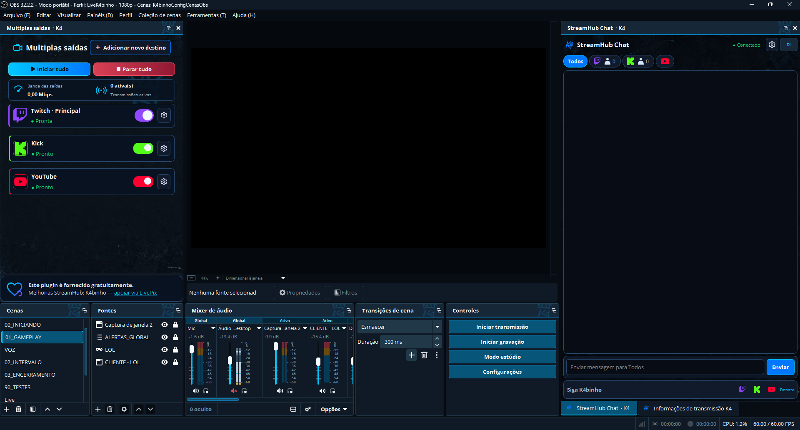
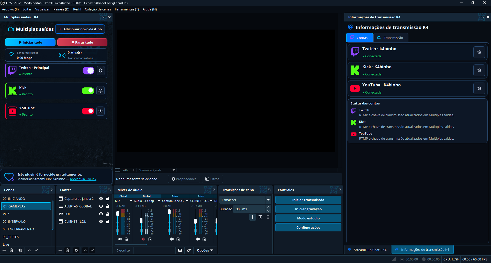
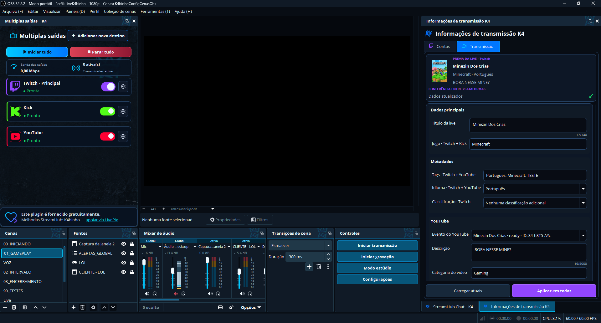
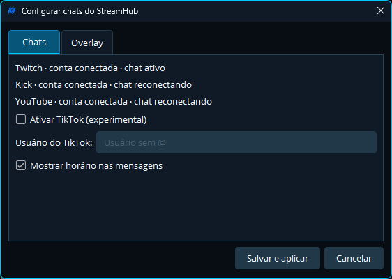
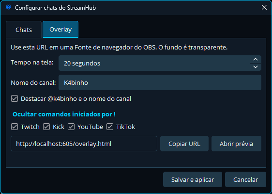
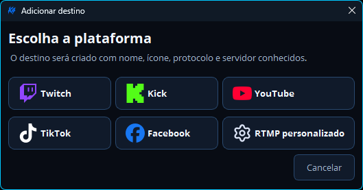
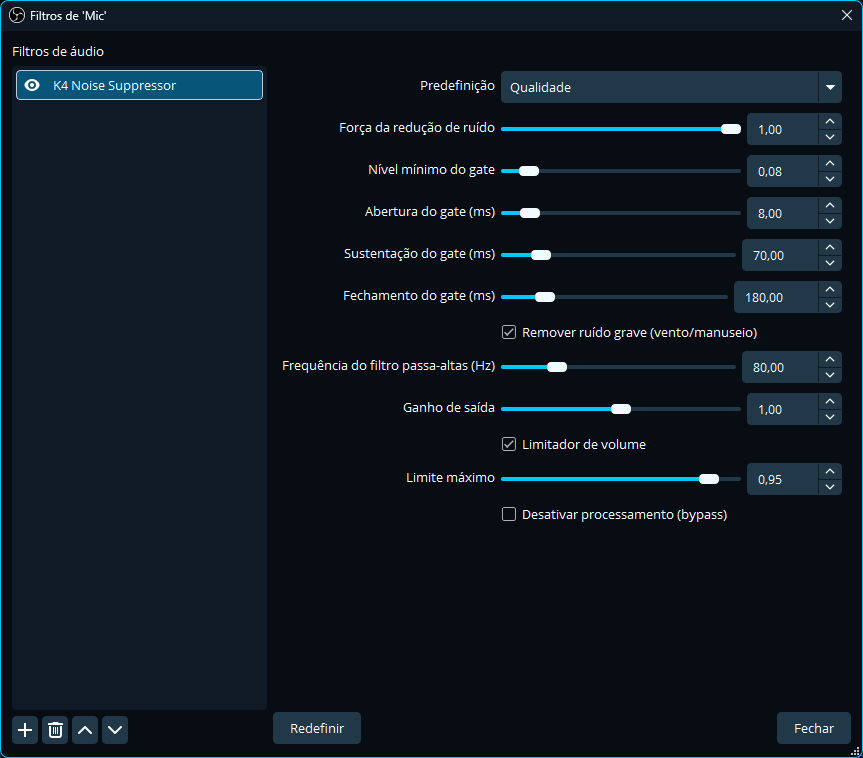
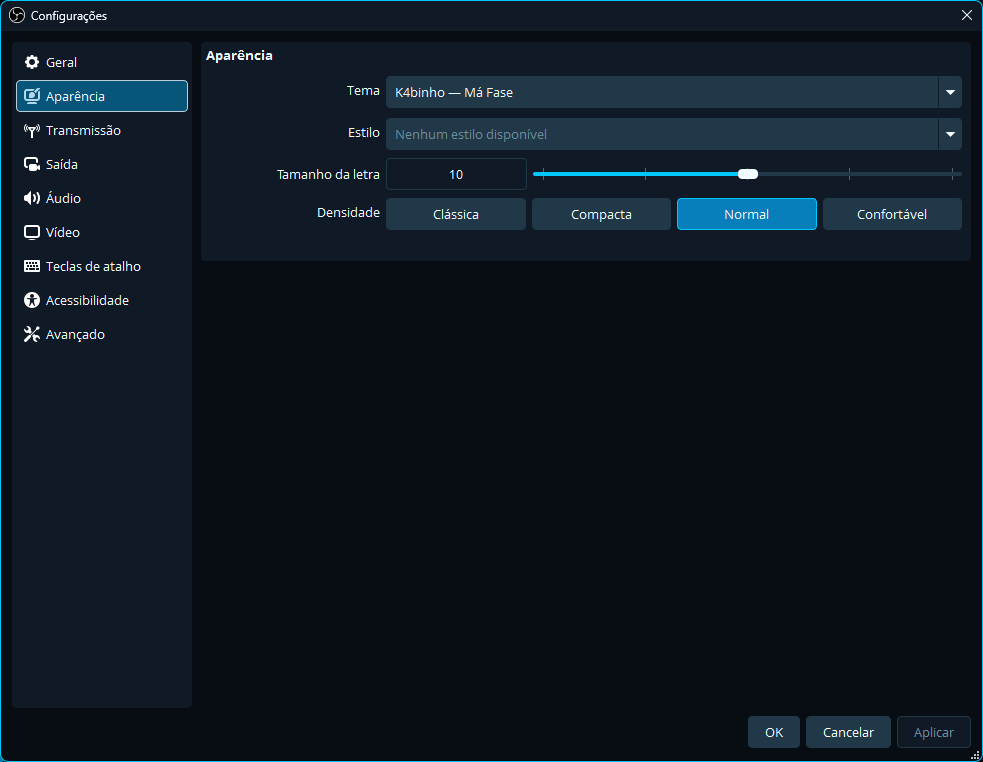

# StreamHub para OBS

**Transmita para vários destinos, acompanhe os chats e atualize as informações da live em um só lugar.**

O StreamHub é um plugin para OBS Studio que reúne saídas RTMP, chat multiplataforma, ferramentas de transmissão e um overlay personalizável. A interface e o tema foram feitos para o fluxo de trabalho do canal K4binho, e o projeto mantém seus componentes organizados para facilitar manutenção e contribuição.

[Baixar a versão mais recente](https://github.com/K4binho/StreamHub_ObsPlugin/releases/latest) · [Ver documentação](docs/project/BUILD_AND_USAGE.md) · [Arquitetura](docs/project/ARCHITECTURE.md) · [Reportar um problema](https://github.com/K4binho/StreamHub_ObsPlugin/issues)

## Visão geral

<p align="center">
  
</p>

O StreamHub adiciona três áreas principais ao OBS: **Múltiplas saídas · K4**, **StreamHub Chat · K4** e **Informações de transmissão K4**. O servidor local e o overlay acompanham a DLL, sem exigir que o usuário copie manualmente as pastas internas do projeto.

O editor vertical acrescenta os painéis **Canvas vertical**, **Cenas verticais** e **Fontes verticais**, com uma composição 9:16 independente da prévia horizontal.

## O que você encontra

| Recurso | O que faz |
| --- | --- |
| **Múltiplas saídas** | Organiza a transmissão principal do OBS e destinos RTMP adicionais em cartões, com controles individuais ou ações para iniciar e parar tudo. |
| **Destinos** | Permite configurar Twitch, Kick, YouTube, TikTok, Facebook e RTMP personalizado. Servidor e chave ficam ocultos por padrão. |
| **Chat unificado** | Reúne mensagens dos conectores habilitados, permite filtrar e enviar mensagens, e evita repetir no dock a mesma mensagem enviada para vários chats. Kick usa eventos oficiais via webhook; TikTok continua sem leitura até haver uma API oficial de chat LIVE disponível. |
| **Moderação** | Oferece ações disponíveis conforme a plataforma e as permissões autorizadas da conta. |
| **Informações da transmissão** | Conecta contas e organiza título, categoria, tags, idioma, descrição e outras opções suportadas por cada plataforma. |
| **Overlay** | Exibe mensagens em uma fonte de navegador transparente do OBS, com duração, canal destacado e filtros configuráveis. |
| **K4 Noise Suppressor** | Inclui o filtro de redução de ruído baseado em RNNoise na DLL principal do plugin. |
| **Tema K4binho — Má Fase** | Aplica identidade visual, ícones e tema integrado ao OBS. |
| **Canvas vertical** | Organiza cenas e fontes em 9:16, com edição, encaixe, sincronização de cenas e controles próprios. |
| **YouTube horizontal + vertical** | Mantém duas saídas com chaves distintas e controle conjunto pelo cartão YouTube. |
| **Abertura do OBS** | Protege o fundo da prévia com preto e antecipa a restauração dos painéis salvos. |

## Capturas do projeto

### Contas e transmissão

<p align="center">
  
  
</p>

### Chat e overlay

<p align="center">
  
  
</p>

### Destinos RTMP, áudio e aparência

<p align="center">
  
  
</p>

<p align="center">
  
</p>

## Compatibilidade e estado dos conectores

O projeto oferece destinos RTMP para Twitch, Kick, YouTube, TikTok, Facebook e servidores personalizados. Isso configura a saída de vídeo; não significa que todas essas plataformas tenham integração de chat ou moderação.

| Plataforma | Saída RTMP | Chat e recursos da conta |
| --- | --- | --- |
| **Twitch** | Destino RTMP e sincronização de servidor/chave disponíveis. | Chat, envio e moderação conforme permissões concedidas. |
| **Kick** | Destino RTMP e fluxo OAuth/sincronização disponíveis. | Leitura usa evento oficial `chat.message.sent` via webhook; exige `events:subscribe`, webhook público configurado e autorização renovada. Envio e moderação usam a API oficial. |
| **YouTube** | Destino RTMP e fluxo OAuth disponíveis. | O chat exige uma live com chat ativo; leitura, edição da live e envio precisam ser validados em uma transmissão real. |
| **TikTok** | Pode ser configurado como destino RTMP. | Leitura do chat pausada; não é iniciada integração baseada em protocolo não oficial. |
| **Facebook** | Pode ser configurado como destino RTMP. | O conector de chat não está implementado. |
| **RTMP personalizado** | Endereço e chave configuráveis pelo usuário. | Sem integração de chat fornecida pelo StreamHub. |

Os recursos das APIs podem variar por conta, permissões, região e estado da transmissão. A documentação técnica registra o que foi validado e o que ainda está pendente; consulte [Manual e build](docs/project/BUILD_AND_USAGE.md) e [Arquitetura e contexto](docs/project/ARCHITECTURE.md).

### Validação em 24/10/2026

- **YouTube:** teste privado confirmado pelo usuário com as prévias horizontal e vertical recebidas pelo Studio em qualidade “Excelente”. Isso valida o envio de vídeo nesse teste, não todos os recursos de chat e metadados.
- **Vertical do YouTube:** no Studio, selecione **Codificador** e associe uma segunda chave à versão vertical. **Corte automático** usa um recorte da horizontal, não o canvas do OBS. Para próximos eventos, use **Reutilizar configurações** e confira o modo e a chave antes de começar; a persistência desse campo entre eventos ainda não foi validada.
- **Abertura:** fundo preto e restauração antecipada do layout implementados; não houve gravação quadro a quadro para comprovar ausência de qualquer transição.
- **Twitch Dual Format:** funcionamento confirmado pelo usuário em teste real, usando Enhanced Broadcasting com o canvas adicional **StreamHub**. Veja a [configuração e evidências](docs/project/TWITCH_DUAL_FORMAT.md). Isso não comprova chat, moderação ou estabilidade em sessões prolongadas; esses testes seguem no [roteiro Twitch](docs/project/TWITCH_TEST_PLAN.md).

As mudanças descritas podem estar no código-fonte antes de um novo release. Confira a versão e as notas do pacote baixado.

## Instalação

1. Baixe a DLL no [release mais recente](https://github.com/K4binho/StreamHub_ObsPlugin/releases/latest).
2. Feche o OBS antes de substituir o arquivo.
3. Copie a DLL para `obs-plugins/64bit` da instalação do OBS que você usa.
4. Abra o OBS e confira os docks no menu **Painéis**.

Os recursos do servidor local, ícones, tema e overlay são incorporados à DLL e extraídos pelo plugin quando necessário. Não substitua a DLL enquanto o OBS estiver aberto. Consulte o [guia completo de instalação e uso](docs/project/BUILD_AND_USAGE.md) para detalhes sobre permissões, contas, primeira execução e solução de problemas.

## Compilar no Windows

### Requisitos

- Windows 10 ou 11 de 64 bits;
- Visual Studio 2022 ou Build Tools com **Desenvolvimento para desktop com C++**;
- CMake 3.28 ou superior;
- Git.

### Comandos

Na pasta `plugins/obs`:

```powershell
cmake --preset windows-x64
cmake --build --preset windows-x64 --config RelWithDebInfo
ctest --test-dir build_x64 -C RelWithDebInfo --output-on-failure
```

A DLL é gerada em `plugins/obs/build_x64/RelWithDebInfo/obs-multi-rtmp.dll`. A compilação incorpora o RNNoise à DLL principal; não é necessário instalar uma segunda DLL do supressor.

## Como o repositório está organizado

```text
apps/
  local-server/       servidor local, conectores e overlay
  oauth-broker/       broker OAuth hospedado
plugins/obs/          plugin C++/Qt para OBS
libraries/            bibliotecas do projeto, incluindo o supressor
tests/                testes automatizados
third_party/          dependências externas
deployment/           arquivos de implantação
docs/                 manuais, arquitetura e imagens de apresentação
tools/                utilitários de build, atualização e publicação
```

O plugin OBS controla os docks e as saídas RTMP. O servidor local concentra conectores, chamadas às plataformas e tokens. O broker OAuth trata os fluxos que precisam de um retorno HTTPS público. Essa separação ajuda a manter cada parte com uma função definida; veja o [documento de modularização](docs/project/MODULARIZATION.md).

O editor vertical está dividido em coordenação, prévia, interação, painéis, cenas e fontes; veja o [mapa dos módulos](docs/project/VERTICAL_EDITOR_MODULARIZATION.md). A proteção de abertura está em `src/ui/streamhub-startup-window.*`, separada do tema nativo em `src/ui/streamhub-native-theme.*`, dentro de `plugins/obs`.

Para executar os testes do servidor local:

```powershell
cd apps/local-server
npm ci
npm test
```

Os testes usam respostas simuladas; não iniciam lives nem comprovam funcionamento das plataformas em uma conta real.

## Segurança e privacidade

- Não compartilhe nem publique stream keys, tokens ou arquivos privados de contas.
- Chaves RTMP ficam ocultas na interface por padrão.
- Client Secrets do fluxo OAuth compartilhado ficam no broker, fora da DLL.
- O servidor local escuta em loopback por padrão.
- Não envie arquivos `.env` ou `accounts-private.json` ao GitHub.
- Consulte a [Política de Privacidade](https://streamhub-oauth-broker.onrender.com/privacidade) e os [Termos de Uso](https://streamhub-oauth-broker.onrender.com/termos). Não inclua dados pessoais em issues públicas.

## Desenvolvimento e contribuição

Antes de alterar o projeto, confira `docs/project/ARCHITECTURE.md`, `docs/project/BUILD_AND_USAGE.md` e `docs/project/MODULARIZATION.md`. Mudanças no plugin devem preservar configurações existentes do OBS, opções avançadas de saída e arquivos privados do usuário.

Para relatar um erro, abra uma [issue](https://github.com/K4binho/StreamHub_ObsPlugin/issues) e inclua a versão do OBS, a versão do StreamHub e as etapas para reproduzir. Remova tokens, URLs de callback com códigos e chaves dos logs antes de anexá-los.

## Licença

Consulte a [licença do plugin](plugins/obs/LICENSE) e as licenças das dependências, como `third_party/rnnoise/COPYING`.
